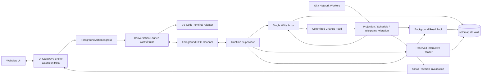

# SoloMap 交互与 Runtime 并发架构纠偏蓝图

更新：2026-10-31。本文以 SoloMap 当前已有的全部产品能力、真实 57 项目和 19GB 权威库为输入，重新设计插件的交互、数据、调度和后台执行架构。这不是在现有串行链路上减少几次查询或增加超时，而是建立新主链、完成整体切换并退役旧主链。

本文不改变《SoloMap 单一数据库实施与验收蓝图》定义的产品能力、数据语义和文件边界；它取代其中“一个 Runtime 同步执行所有操作”和“Webview 消费全量状态投影”的实施方式。

## 1. 最终用户结果

SoloMap 是用户推进项目和发起 Agent 工作的行动工具。目标架构必须保证：

- 从任何入口发起对话时，用户动作立即进入独立前台链路，不等待项目组合、日评、账户、统计、Git、远端信号、迁移、诊断或 UI 全量渲染。
- 一个项目的慢查询、Git 仓库、远端接口或后台 Agent 不能拖慢其他项目的打开、切换、输入和发起。
- 数据库保持一个权威写入者和提交后即时可读，但读取、投影、网络、Git、渲染和维护不再与写入者共用一个同步事件循环。
- 缓存、降级、诊断和超时只服务主结果；不允许用“更早失败”代替“真正启动”。

## 2. 现实负载与已观测事实

### 2.1 生产规模

2026-10-31 只读核对：

- 正式项目注册表包含 57 个项目。
- `solomap.db` 为 19,386,109,952 字节，WAL 约 16MB。
- 当前宿为 4 vCPU、23GiB 内存；采样时 Runtime 约占 48% CPU，Extension Host 约占 18% CPU，并存在多个 Git 子进程。
- Sidebar 可消费项目卡片、路线图、对话、Issue、PR、交付、安全、投入统计、日评、账户、设置、数据概览、Agent 影响、协作和迁移状态。
- 当前 Sidebar Webview 处理至少 55 类宿主消息，Extension 共享动作面约 86 类命令，Runtime 数据服务约 231 类操作。

### 2.2 对话阻塞时序

`ui:mvwd2yvq:4db1efac-80ca-4b52-b994-36953e65d83a` 的正式诊断：

1. Webview 在 `12:12:33.686` 创建对话动作。
2. Extension Host 首次在 `12:13:35.675` 收到该动作，入口前已等待约 61.99 秒。
3. Host 收到后 8.25 秒启动 Agent 进程，首段输出随后约 0.59 秒到达。
4. 同一 interaction 每约 5 秒重试，后续成批到达 Host；持久幂等防止了重复 Agent，但没有修复用户入口延迟。

结论：Agent CLI 不是该次 62 秒等待的主阻塞点；主阻塞在 Webview 动作与 Host 处理之前的共享交互基础设施。

### 2.3 共享通道拥塞

最近 1000 条 operation 诊断中，最近 6 小时的 997 条包含：

- `sidebar.action.getDailyReview` 460 条。空闲时每 30 秒轮询，运行时每 2.5 秒轮询。
- `sidebar.action.conversation.runSolo` 104 条，包含同一动作的交通重试。
- `settings.delivery` 有 263–361 秒投递，`database.overview.delivery` 有 263–334 秒投递，`agentImpact.delivery` 有 240–489 秒投递。
- `agentImpact.read` 多次耗时 16–24 秒。

这些 `delivery` 阶段围绕同一 `webview.postMessage` 边界。因此“对话确认也走同一通道”是结构性错误，不是多等几秒可以解决的慢查询。

## 3. 现架构全链路审计

| 执行域 | Observed in code | 设计缺陷 | 直接后果 |
| --- | --- | --- | --- |
| Webview 用户动作 | 发送 `conversation.runSolo` 后同一 JS turn 立即调用 `renderPortfolio` | 发送与整个组合区重建耦合；消息离开 Webview 前可被同步渲染拖延 | 用户点击已发生，Host 长时间看不到 |
| Webview 入站消费 | 一个 `window.message` switch 同步合并数据、重算组合并重建 DOM | 没有消息优先级、帧预算、稳定键局部更新和输入抢占 | 背景投影可占用浏览器事件循环 |
| Webview 交通 | 前台确认、设置、统计、数据概览和所有项目数据都直接调用 `postMessage` | 没有统一 broker、队列上限、取消、合并、可见性订阅和前台保留容量 | 大负载形成队头阻塞，确认也无法越过 |
| Extension Host 动作分发 | Sidebar 先进入通用 async `dispatchSharedAction` | UI 入口、数据动作和长任务缺少独立网关 | 一个交互宿主同时承担业务、数据和 VS Code API 调度 |
| Sidebar 项目投影 | 选中项目后仍顺序读取其余所有项目对话；每个项目可发送 solo/project/flow/revision 四组数据 | 把“当前可见项目”错设成“全部项目预热”；无背压 | 57 项目引入 N+1 查询与消息放大 |
| 项目增强 | 每项目读投入、可复用源、文档和活动；四类外部信号另起队列 | 一次 Sidebar 打开发展成全组合后台重算 | CPU、DB、Git、网络和 UI 更新互相放大 |
| Runtime RPC | 每请求新建 TCP 连接；优先级调度器从队列选择下一项 | 没有长连接多路复用、取消、截止时间传递和资源隔离 | 调度标签无法保证真实资源优先级 |
| SQLite owner | `DatabaseSync` 和全部域操作在同一 Runtime 事件循环执行 | 虽然 RPC promise 可交错，任何同步 SQL/序列化/文件工作都会阻塞全 Runtime | 优先级不可抢占，长读和维护放大前台延迟 |
| 诊断 | operation/error 记录通过同一数据操作持久化 | 可观测性与被观测的前台工作竞争写入 | 负载越高，诊断越多，反过来继续放大负载 |
| 测试 | Webview `postMessage` 在回归中通常立即 resolve | 没有真实通道阻塞、大投影、浏览器长任务和 57 项目压力 | accepted/settled 状态机可全绿，真实用户仍等待一分钟 |

### 3.1 为什么会被设计成串行链路

这不是 SQLite 或单库天然要求，而是四个架构概念被错误合并：

1. 把“一个权威写入者”误解成“所有读写、投影、诊断和维护只能由一个事件循环执行”。单一权威约束提交顺序，不约束只读计算、外部 IO 和 UI 投影必须串行。
2. 把“一个统一产品状态”误解成“每次都构造并推送一个全量状态对象”。统一用户心智不要求全量快照；正确实现是稳定实体、revision 和按需 delta。
3. 把 JavaScript `async` 误当成资源并行。同步 SQLite、JSON/DOM 构造和同一 Webview 通道即使包在 Promise 中，仍共享一个不可抢占事件循环。
4. 用优先级标签代替物理隔离。只要前台与后台仍争用同一连接、同一线程或同一投递 promise，调度器只能决定“下一个开始谁”，不能让已经开始的长工作让路。

数据库架构升级扩大了权威库、查询和投影的覆盖面，却没有同时重划执行域；于是原本分散的成本被集中到一条宿主链上。根因不是“数据库太大”，而是把一致性边界扩大成了执行串行边界。

## 4. 目标拓扑



### 4.1 进程与责任边界

#### Extension Host

只保留必须使用 VS Code API 的责任：

- Webview 创建与 UI 命令网关。
- 终端创建、显示、输入交付和宿主事件观测。
- 编辑器命令、本地文件选择和 SecretStorage 适配。
- 一份小型、只读、有 revision 的当前项目/设置路由快照，仅用于快速验证和路由。

Extension Host 不再执行：

- 全项目数据库聚合。
- 全项目 Git 扫描或远端信号刷新。
- 大对象快照构建。
- 数据库维护、迁移、诊断批量写入。

#### Runtime Supervisor

- 拥有 Runtime 发现、版本交接、身份、健康和子进程生命周期。
- 提供持久化多路 RPC，至少分为 foreground、interactive-read、background 三个逻辑通道。
- 只做路由、截止时间、取消和子进程健康管理，不执行同步 SQL 和长时间业务计算。

#### Single Write Actor

- 唯一可写 SQLite 连接，保留现有事务、外键、revision、幂等和即时回读合同。
- 只接受已验证的 command；query 不经过写 Actor。
- 前台 command 在队列中拥有保留容量。后台工作必须分块，每个事务有最大执行预算，块与块之间让行。
- 网络、Git、Agent 调用、全文序列化、备份压缩和大文件读取不得位于写事务内。

#### Read Processes

- 使用 SQLite WAL 上的独立 read-only 连接，不使用 active database 不适用的 immutable 模式。
- 4 vCPU 正式默认为一个保留交互读进程和一个后台读进程；不根据项目数量无界增长。
- 交互读进程只处理当前用户动作和当前可见作用域。后台读进程不能占用该席位。
- 查询必须有截止时间、返回上限、页面/实体键和 revision；超大全量结果改为分页或持久投影。

#### Projection / External Workers

- 从写事务产生的 committed change feed 读取变化，增量更新项目摘要、日评、统计和其他读模型。
- 不以 Sidebar 打开为触发全量重算的条件。
- Git 与网络使用分开的有界 worker；项目可见、用户手动刷新和后台刷新使用不同优先级，但不能占用前台 DB 读进程。

## 5. 数据和一致性模型

### 5.1 Command / Query 分离

所有 Runtime 操作必须分类：

- `command`：改变权威状态，由 Write Actor 事务执行。
- `interactive_query`：服务当前用户动作，由保留 Reader 执行。
- `background_query`：聚合、投影、迁移核对和后台分析，由后台 Reader 执行。
- `external_job`：Git、HTTP、Agent 分析和文件生成，由对应 Worker 执行；仅最终提交进入 command。
- `maintenance`：迁移、备份、存储回收和索引维护，由专用进程分块执行，不允许与前台争抢保留 Reader。

操作分类是显式注册表，不再用正则对操作名推测优先级。未分类操作不能启动 Runtime。

### 5.2 读模型

- Sidebar core 是正式增量读模型，不是视图级 JSON 快照。
- 项目列表只返回卡片摘要和 revision；当前项目的路线图、最近对话、Issue/PR 细节按可见作用域读取。
- 不在打开 Sidebar 时读取 57 个项目的全部对话、文档、投入和外部信号。
- 同一实体投影使用 `entityKey + revision`；旧 revision 可进入缓存，不得更新当前 UI。
- 对于日评、Agent 影响和数据概览，投影完成后发布 revision invalidation，Webview 在相应面板可见且空闲时拉取 delta；不再定时全量轮询。

### 5.3 提交与投影

- 权威 command 事务同时写入业务变更和 outbox event。
- command 回执在事务提交后返回；回执携带 authority revision。
- 投影 Worker 幂等消费 outbox，完成后更新 projection revision。
- UI 可立即使用 command 回执更新动作结果，不等待全组合投影。后续 projection delta 只合并衍生字段。

## 6. UI 协议与渲染架构

### 6.1 消息协议

每个消息都有：

- `protocolVersion`
- `messageId`
- `interactionId` 或 `subscriptionId`
- `lane`: `foreground | interactive | background`
- `entityKey`
- `revision`
- `deadlineAt` 或明确无用户截止时间
- `supersedesKey` 用于合并可被新版取代的后台更新

不再允许业务模块直接调用 `webview.postMessage`。所有 Host → Webview 消息经 UI Broker：

- foreground 回执和失败不合并，按 interaction 保序。
- interactive 查询结果按 `entityKey + requestId` 保序。
- background 更新按 `supersedesKey` 只保留最新 revision，只在无 foreground 待发且 Webview 有容量时投递。
- 不投递不可见面板的大负载，只投递小型 invalidation。

### 6.2 Webview 事件循环

- 用户点击处理器只构建已冻结输入、调用 `vscode.postMessage` 和对当前控件做 O(1) 的本地状态修改。
- 发起对话后不得在同一 JS turn 重建 portfolio、任务列表或对话历史。
- 入站 background delta 进入客户端调度器，每帧有 CPU 预算；检测到待处理输入时立即让行。
- 项目卡片、对话、Issue 和状态使用稳定键局部 patch，不再用整个 `portfolioList.innerHTML` 重建作为普通更新机制。
- 长列表只渲染可见窗口和必要缓冲区；用户草稿、焦点、选区和滚动状态归稳定实体节点所有。

## 7. 对话发起正确主链

```text
T0 Webview 点击/Enter
  → 冻结 project/input/agent/model/attachments/interaction budget
  → 立即 post foreground command
  → O(1) 标记本地“正在开始”

Extension Foreground Ingress
  → 同步验证协议和内存路由快照
  → 登记 interaction single-flight
  → 立即发 transport-received
  → 启动 Launch Coordinator，不经过通用 UI action 队列

Launch Coordinator（并发分支）
  ├─→ VS Code Terminal Adapter 创建并显示本次专属终端
  ├─→ Runtime foreground command 持久接收本次启动意图
  └─→ Interactive Reader 并行读取当前项目最小启动上下文

三者都就绪
  → Write Actor 一个短事务 claim/prepare run
  → 共享 runner 向已有终端交付命令
  → Provider 真实 task-ingress 回执
  → UI 收到 started
```

硬性不变量：

- 主链不读 portfolio、daily review、agent impact、database overview、其他项目对话或外部信号。
- 所有入口使用同一 `LaunchRequest` 和 `LaunchCoordinator`，入口不自建准备/终端/调度特例。
- 接收、持久化接受、终端就绪、runner claim、Provider ingress 是不同阶段，不能用前一阶段冒充后一阶段。
- 发起失败时原始输入可恢复；成功只启动一个任务；重试复用 interaction identity。
- 不通过提前超时、取消数据完整性或跳过启动准备来达到延迟目标。

## 8. 其他当前产品需求的路由

| 工作类型 | 正式执行域 | UI 数据方式 | 不得阻塞 |
| --- | --- | --- | --- |
| 项目切换 | Foreground Ingress + Interactive Reader | 当前项目 core delta | 全项目投影、外部信号 |
| 路线图与当前任务 | Interactive Reader | 当前项目 revision snapshot/delta | 投入统计、GitHub |
| 设置读写 | Interactive Reader / Write Actor | 字段 revision patch | 能力探测、账户刷新 |
| Issue/PR 动作 | Foreground command + External Worker | 动作回执 + 实体 delta | 其他项目信号 |
| 日评/战略/Agent 影响 | Background Projection / Agent Worker | 可见时拉取最新 revision | 插件打开、对话、项目切换 |
| 外部信号 | Network Worker | 最后成功投影 + 实体 delta | 本地卡片和任何输入 |
| Git 读取/证据 | Git Worker | 运行或项目级 revision | Extension Host 事件循环 |
| Telegram/调度/通知 | Runtime Background Workers | 持久状态和投递事件 | UI foreground lanes |
| 迁移/备份/回收 | Maintenance Process | 按需进度 delta | 所有前台动作和交互 Reader |
| 诊断 | 低优先批量 Writer | 仅明确打开诊断面时查询 | 任何被观测的业务工作 |

## 9. 资源、并发与背压

### 9.1 宿默认预算（4 vCPU / 23GiB）

- Write Actor：1 进程、1 写连接。
- Interactive Reader：1 进程、1 读连接，只服务用户动作。
- Background Reader：1 进程、1 读连接，聚合内部可有界并发。
- Git Worker：全局最多 1 个活动 Git 重操作，用户明确动作可在队列前置，不中断已在写工作区的安全操作。
- Network Worker：默认 2 个并发，按 host 和 credential 另有限制。
- 后台 Agent：与用户交互 Agent 分开并发槽；后台 Agent 不占用用户启动槽。

这些是基于当前正式宿的起始值，必须通过压力测调整；不允许用项目数量直接扩大进程数。

### 9.2 背压和取消

- 每个队列都有显式容量、合并键、截止时间和溢出行为。
- 后台刷新以 `project + signalKind` 合并；重复请求只保留最新意图，不累积为无界队列。
- UI background delta 以 `view + entityKey` 合并。用户离开面板时撤销订阅和未投递大负载。
- 取消只撤销尚未提交的读取/投影/外部工作；已接受的权威写入按幂等合同完成或明确失败。
- 队列溢出时先丢弃被新 revision 取代的后台投影；不丢弃用户 command、已提交回执或恢复必需事件。

## 10. 时限与可反证验收

### 10.1 对话主链

- click/Enter → Webview 完成 `postMessage`：p95 小于 16ms，单次小于 50ms。
- click/Enter → Host foreground ingress：p95 小于 100ms，发布硬上限 250ms。
- click/Enter → 持久接受与专属终端可见：正常目标 1s，发布硬上限 2s。
- click/Enter → 真实 Agent task ingress：正常目标 5s，发布硬上限 10s，沿用现有产品基线。
- 在同时运行全项目后台刷新、日评、Agent 影响、数据概览、迁移检查和诊断持久化时，上述上限不变。

### 10.2 资源断言

- 发起一次当前项目对话时，其他 56 个项目的 DB 查询数和 Webview 负载必须为 0。
- Sidebar 空闲 10 分钟不产生定时全量读取；只有状态变化事件或用户动作可触发查询。
- background 队列在重复不变输入下保持有界，同键任务不随时间累积。
- Write Actor 长任务分块后，任意前台 command 等待当前不可抢占事务的时间有明确上限。
- UI Broker 不存在无界待投递消息；后台更新可合并，前台事件可追踪且不丢失。

## 11. 故障、恢复与升级

- Supervisor 监测 Writer/Reader/Worker；某个 Reader 或外部 Worker 崩溃不影响权威写者和其他读者。
- Write Actor 失去时，新 command 保留原始输入并显式恢复；不退回旧文件写入或第二数据库。
- Reader 失去时可重建连接并从 authority revision 恢复；不会影响已提交 command。
- Projection Worker 重启后从 outbox cursor 幂等续读；不扫描全库来猜测丢失变化。
- Runtime 版本交接先启动并验证新 Supervisor/Actor 组，再排空旧组；不中断已提交任务。

## 12. 实施与旧链退役

这是一个目标架构切换，不是长期双轨。实施可在开发期分包，但发布候选必须只剩一条主链。

### 12.1 2026-10-31 实现审计状态

下表只记录代码中已经观察到的事实。`未切换` 项仍是发布阻断项，不能用本轮已完成部分冒充整个目标架构完成。

| 架构面 | 当前状态 | Observed in code | 退役/完成条件 |
| --- | --- | --- | --- |
| Webview 发起动作 O(1) | 已切换 | Solo、Step、Flow、Continue 发送路径不再在同一 turn 重建 portfolio；附件清理由稳定 DOM 节点完成 | Chromium 回归持续证明发送不调用组合区渲染 |
| Host → Webview UI Broker | 已切换 | `panelMessages.ts` 统一协议封装；foreground 可越过未完成 background；同键 background 只保留最新 revision；声音投递也进入 broker | 生产代码不存在业务 `webview.postMessage` 直投 |
| 空闲日评轮询 | 已退役 | Sidebar 不再创建 2.5 秒/30 秒轮询；仅首次可见、状态失效或用户动作读取 | 10 分钟空闲压力下日评查询数为 0 |
| Runtime RPC | 已切换 | 数据 RPC 使用一条认证长连接并按 `requestId` 多路复用、允许乱序回包；滚动交接兼容旧版单帧响应；断线后只重放只读操作、带幂等键的写入和带 `openRequestId` 的会话建立，结果不明的非幂等写入明确失败；旧 Runtime 先排空已接受工作再关闭连接 | 重启、断线、单次子进程、并发、安全重放、旧版交接与认证回归全部通过 |
| Runtime 操作分类 | 已切换 | 235 个操作进入显式 registry；每项分别声明 kind、lane/domain、executor affinity、replay policy 和 authority；未注册操作在生产控制面拒绝 | 新增操作必须同时声明五维合同并通过完备性测试 |
| 交互读/后台读 | 已切换 | 两个独立 worker thread、两个 SQLite read-only 连接；交互读与后台读物理分开；依赖 Runtime 内存的 query 明确留在 Supervisor，不再误投只读 worker | 真 WAL 长读压力下交互读仍满足时限 |
| 外部/维护执行器 | 部分切换 | project signals 进入独立只读 External Worker；maintenance 进入独立可写 Worker；四个 worker 与 Supervisor 均为不同 thread | Git/网络全部操作完成亲和性迁移；维护写入增加全局 fence/分块和前台等待上限 |
| 唯一写入者 | 部分切换 | 普通 command 与 session/fence 仍归原 Writer；为隔离同步维护，maintenance 已有独立连接，因此“单一 Write Actor”目标尚未成立，当前一致性仍依赖 SQLite 事务和操作幂等 | Write Actor 独立进程；Maintenance 通过 actor 分块提交而不是持有第二条无围栏写连接 |
| Sidebar 首屏 | 部分切换 | 立即投递无 IO placeholder；启动只恢复选中项目缓存对话；core 使用最多两个持久 worker 的有界池并按项目去重；不再预读其余 56 个项目对话 | 用 outbox 增量投影替代视图启动时的全项目 core 重算 |
| Sidebar 增量读模型 | 未切换 | 当前仍会在 worker 内按项目构造 core，增强层仍逐项目读取 | 正式 projection 表、cursor、revision invalidation 和可见作用域 delta 上线后删除旧扫描 |
| Git/网络执行域 | 未切换 | 已有有界异步队列，但 Git/网络工作尚未成为 Supervisor 管理的独立 worker 进程 | Git Worker/Network Worker 具备独立容量、取消、健康与重启合同 |
| Launch Coordinator | 部分切换 | Sidebar Solo/Step/Flow、内部 Step/Solo/Flow、Time Plan、路线图调整、Retry、原生 Continue 和项目 Step 已共享并行终端/Runtime 准备协调器；Continue Turn、调度和经验复盘仍有专用链 | 所有会启动 Agent 的入口使用同一 LaunchRequest、幂等和 task-ingress 阶段合同 |
| Webview 增量渲染 | 部分切换 | 发起动作已脱离全量 render；普通 portfolio 更新仍存在整区 HTML 重建 | 稳定键 patch、帧预算、输入抢占和长列表可见窗口完成后删除全量普通更新路径 |
| deadline/cancel/backpressure | 部分切换 | UI background 最多 128 个实体键、单键最多 64 个 waiter，超期消息丢弃；Runtime 五条 lane 有独立并发上限；RPC 有多路复用；accepted work 与 socket 生命周期分离并在断线后继续 drain | deadline/cancel 继续贯穿 Reader/Worker；foreground command 增加持久保留容量 |
| 正式负载验收 | 未完成 | 已有隔离单测、SQLite 集成和 Chromium 点击回归用例；当前宿缺少 Playwright，因此本轮真实 Chromium 用例跳过，且尚未完成 57 项目/19GB/全后台并发的发布压测 | 第 10、13 节全部硬指标产生同一版本证据 |

因此，本轮代码纠偏已经替换导致 62 秒阻塞的关键主路径，但整个蓝图仍不得标记为“全部完成”。下一阶段不是继续给旧链加超时，而是按表中退役条件完成剩余执行域切换。

### 包 A：协议与负载基线

- 固化全部用户入口、Runtime 操作和 UI 消费者清单。
- 建立真实 Webview/Host/Runtime 端到端拥塞回归。
- 建立 57 项目、19GB 库、4 vCPU 的可重复资源基线，不修改生产库。

### 包 B：Runtime 执行域替换

- 落地 Supervisor、Write Actor、Interactive Reader、Background Reader 和显式 operation registry。
- 建立持久多路 RPC、取消、deadline 和健康交接。
- 将全部操作迁入显式 command/query/job 分类；未分类操作不得保留隐式旧路由。
- 退役原 `RuntimePriorityScheduler` 和每请求新建 TCP 连接的主路径。

### 包 C：UI Gateway 与读模型替换

- 所有 Webview 发送进入 UI Broker，所有用户动作进入 Foreground Ingress。
- 建立 Sidebar core 增量读模型、可见作用域订阅和 delta 协议。
- 替换全量 portfolio 重建、全项目对话预读和轮询刷新。
- 将 Git/网络/投影工作从 Extension Host 移入 Worker。

### 包 D：统一 Launch Coordinator

- 将 Solo、Step、Flow、Continue、Issue/PR/安全/交付、路线图调整、时间计划、远程、调度和维护入口收口为同一启动合同。
- 每个入口完成真实任务 ingress 计时和幂等验收。
- 退役入口自建的准备、终端和状态特例。

### 包 E：全量验收与单路切换

- 执行全部用户入口、并发、恢复、迁移、备份、多窗口、多 Agent、后台压力和 UI 渲染验收。
- 证明新任务不再进入旧 scheduler、全项目预读、直接 `postMessage` 或全量 DOM 重建路径。
- 删除被替代生产路径的代码和兼容开关；历史数据兼容仅保留 importer，不保留双主链。

## 13. 测试与发布门禁

### 必须先失败的回归

- 一个 background Webview 投递 promise 永不 resolve 时，用户 launch 仍在硬上限内进入 Host 并启动。
- 后台 Reader 运行 30 秒查询时，interactive query 在保留 Reader 上满足时限。
- Write Actor 有迁移/诊断批处理时，foreground command 在下一个短事务边界前置。
- 57 项目数据存在时，启动一次对话不读取其他 56 个项目，不投递任何其他项目负载。
- UI 正在处理大量 background delta 时，点击/Enter 仍先于下一个后台批次执行。
- 同一 interaction 重放 100 次仍只启动一个 Agent，且前台回执不被后台队列覆盖。

### 完整验收

- Runtime 执行域单元、真 SQLite WAL 集成、进程崩溃/重启、多窗口和多 Agent 并发。
- 最终生成 Webview 脚本语法和真实 Chromium/code-server 渲染。
- 57 项目和代表性 19GB 库的只读压力验收；不用小 fixture 外推生产成本。
- 后台外部信号、Git、日评、Agent 影响、数据概览、诊断和迁移同时运行的交互时限。
- 最终 VSIX 安装宿中的点击 → Host → 终端 → runner → Provider ingress 统一 interaction 证据。

任一入口超过现有 10 秒发布硬上限，或任一后台任务可阻塞 foreground 保留资源，本架构都不得标记完成。

## 14. 非目标与边界

- 不改变用户的 SoloMap 入口、项目心智、Agent 选择和数据治理心智。
- 不引入用户需要理解的“快速模式”、“数据库模式”、“后台模式”或手动并发参数。
- 不为性能缩短日志、正文、附件、历史、恢复证据或任务生命周期。
- 不用更早超时、禁用后台功能、跳过数据库权威校验或新增用户等待确认来制造快速假象。
- 不在本架构任务中回收任何历史物理文件；该操作继续受精确清单和用户单独授权约束。
