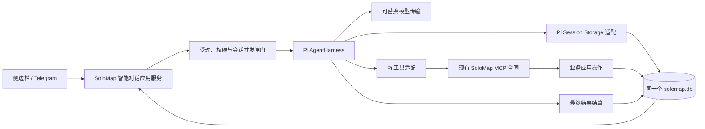
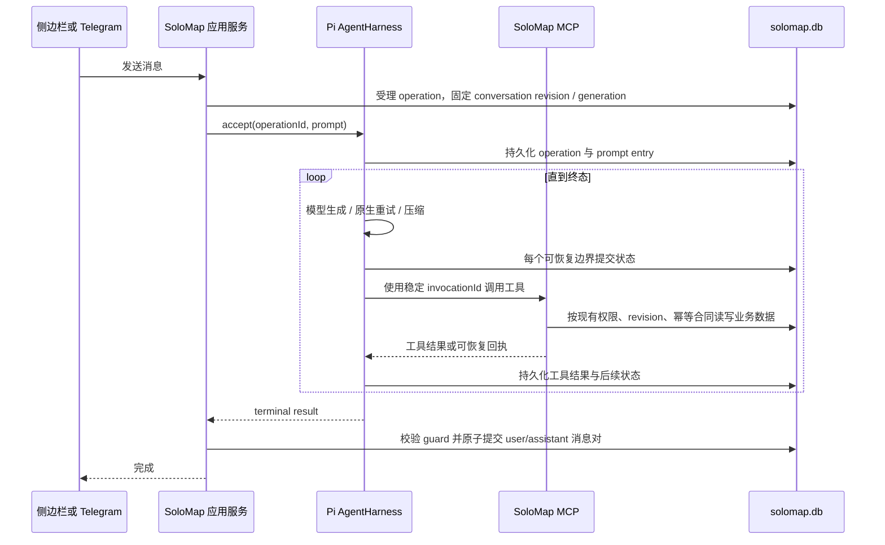

# Pi core 原生执行内核接入蓝图

更新：2026-10-19。

## 1. 目标与结论

目标只有一个：**在不改变 SoloMap 单一权威数据库、业务权限、MCP 接入和用户对话体验的前提下，让 Pi core 原生负责一次智能对话从受理到完成的执行、恢复与压缩。**

推荐采用稳定版 `AgentHarness + StorageBackedSession`，为它实现基于 `UnifiedDataStore` 的持久化适配。Pi core 负责执行内核，SoloMap 负责业务事实和最终结算。两者使用同一个 `solomap.db`，但数据职责严格隔离：

- Pi core 拥有模型循环、工具调用生命周期、重试、队列、中止、恢复、压缩、用量和执行事件。
- SoloMap 拥有项目范围、授权、业务对象、幂等写入、用户可见对话和最终结果提交。
- Pi 工具仍只能通过现有 MCP 合同访问业务数据，不得由 Pi session storage 直接读写业务表。
- 不新增 Pi JSONL、Pi SQLite 或其他第二数据源。
- Agent CLI、模型供应方和传输方式都是可替换依赖，不是本蓝图的架构主体。

这不是用 Pi core 替换 SoloMap 数据架构，而是把 SoloMap 当前自行承担的执行状态机交还给 Pi core。

## 2. 现实基线

以下结论来自当前代码，不把目标设计写成已实现事实。

### 2.1 Observed in code

- [`IntelligenceConversationStore`](../../src/intelligenceChat.ts) 在每次发送前读取数据库对话，把当前用户消息交给引擎，得到最终回复后再把用户消息和助手消息一起写入。
- [`UnifiedDataStore.readIntelligenceConversation` 与 `writeIntelligenceConversation`](../../src/db/unifiedDataStore.ts) 以 `messages` 作为用户可见历史，并使用 revision、idempotency key 和 Telegram generation guard 保护最终提交。
- [`PiAgentEngine`](../../src/piAgentEngine.ts) 当前直接使用 Pi `Agent`，外围仍自行处理流、对话冲突重算和压缩衔接。
- [`intelligenceContextCheckpoint`](../../src/intelligenceContextCheckpoint.ts) 保存的是从完整可见历史派生出的单份压缩投影；完整用户消息仍是权威来源。
- [`bundle-pi-runtime.cjs`](../../scripts/bundle-pi-runtime.cjs) 当前只打包 `Agent` 和若干压缩函数，没有打包稳定版 `AgentHarness`、session 与 storage 接口。
- 当前依赖固定为 `@earendil-works/pi-agent-core@0.87.1`。该版本根导出包含稳定版 `AgentHarness`、`StorageBackedSession`、持久化 `Storage` 合同、恢复入口、队列、重试、压缩和事件；`experimental/pico3` 仍属于实验入口。
- 已发布基线会把工具异常转换成 Pi 可继续处理的错误结果；本蓝图不得回退这项行为。

### 2.2 Inference

当前方案已经实现了“可见历史不丢”和“最终提交有并发保护”，但执行中状态主要留在进程内。进程在模型请求、工具副作用或压缩期间退出后，系统只能从可见历史重新计算，无法从同一执行位置继续。revision 冲突后的整轮重算还可能重复模型调用和工具副作用。

因此，缺口不是再补一层异常捕获，而是让执行中的事实也具备持久身份，并由 Pi core 原生恢复同一个 operation。

## 3. 当前方案与目标方案对比

| 维度 | 当前 `Agent + SoloMap 外围编排` | 目标 `AgentHarness + 同库持久 session` |
| --- | --- | --- |
| 可见对话权威 | `messages`，已经正确 | 保持不变 |
| 执行状态 | 主要在当前进程与 `pending` 队列中 | Pi operation、lane、queue、tool checkpoint 持久化 |
| 模型失败 | 外围处理，语义分散 | 使用 Harness 原生 retry/backoff 和恢复状态 |
| 工具失败 | 已能形成错误结果，但生命周期仍由外围拼接 | 使用 Harness 原生 tool result、事件、checkpoint 和 replay 策略 |
| 进程重启 | 通常从已提交可见历史重跑 | 打开同一 session，恢复同一 operation |
| 并发 | 单实例内串行；跨实例依赖最终 revision 冲突 | 数据库受理闸门 + session mutation，先阻止重复执行 |
| 压缩 | SoloMap 手动调 Pi 压缩函数并保存派生投影 | Harness 原生压缩记录；完整可见历史仍保留 |
| 队列、中止、续跑 | 外围分别维护 | 使用 Harness 原生 queue、abort、resume、events |
| 工具副作用恢复 | 整轮重跑时有重复风险 | 稳定 invocation id + MCP 幂等键；只有满足幂等合同才允许安全重放 |
| 数据成本 | 较低、结构简单 | 同库增加私有执行记录、迁移与保留策略 |
| 实现成本 | 短期低，继续补丁会累积双重状态机 | 初次适配成本较高，完成后删除外围重复逻辑 |

当前方案适合作为迁移基线，不适合作为长期执行内核。目标方案的主要代价是 storage 适配、升级兼容和恢复测试；这些成本换来的是同一 operation 的可验证恢复，而不是“失败后重新来一遍”。

## 4. 终态职责边界

### 4.1 Pi core 的责任

- 接受一次带稳定 `operationId` 的 prompt。
- 持久推进 assistant generation、tool batch、retry wait、compaction 和 terminal result。
- 保存工具参数、结果、增量 checkpoint、调用级 memo 和 usage。
- 在进程恢复后识别 open operation，并继续 `drive` 或按原生语义结束未知结果。
- 处理 steer、follow-up、next-run、abort 和事件流。
- 保证同一 session lane 内的状态迁移满足 Pi 自身不变量。

### 4.2 SoloMap 的责任

- 校验项目、会话、调用来源、权限和当前 generation。
- 为每次用户动作分配稳定业务请求身份，并保证同一会话只有一个已受理的前台 operation。
- 提供 Pi storage 的同库实现，但不得借此绕过业务应用操作。
- 把 Pi 工具调用映射到现有 MCP 工具合同，并延续现有 scope、revision 和幂等语义。
- 在 operation 得到终态结果后，原子提交用户可见的 user/assistant 消息对。
- 管理执行记录与完整可见历史之间的绑定、迁移、保留和诊断。

### 4.3 不属于本决策的内容

- 不改变 Agent CLI 的选择、启动、续聊或会话身份机制。
- 不把某个模型供应方、SDK 或传输协议写成数据架构依赖。
- 不改变 roadmap、项目边界、用户可见消息模型或现有 MCP 业务入口。
- 不采用 `experimental/pico3`；只有其 API 稳定、迁移收益明确并完成独立设计后才重新评估。

## 5. 同库、分域的数据模型

物理上继续只有一个 `solomap.db`，逻辑上分为两个权威域：

| 数据 | 权威 owner | 可见性 | 写入入口 |
| --- | --- | --- | --- |
| 项目、roadmap、记忆、能力、设置等业务对象 | SoloMap | 按现有产品规则 | 现有应用操作 / MCP |
| 用户可见的 user/assistant 消息 | SoloMap | 对用户可见 | 最终结算事务 |
| 对话 revision、generation guard、业务幂等回执 | SoloMap | 内部治理 | 现有会话写入合同 |
| Pi session metadata | Pi 执行域 | 内部 | Pi session repository 适配 |
| conversation ↔ Pi session binding | SoloMap 集成域 | 内部 | 会话 bootstrap / 受理事务 |
| Pi entries、branch、values、lists、usage | Pi 执行域 | 内部 | Pi `Storage.commit` |
| operation、queue、retry、tool memo/checkpoint | Pi 执行域 | 内部 | AgentHarness 原生状态迁移 |
| 实时 token 与工具进度 | Pi 事件为源，前台为临时投影 | 当前交互可见 | event/watch 通道 |

Pi 执行域使用明确的私有命名空间或专用表，不复用 `messages` 冒充 Harness transcript，也不把 Pi 内部 entry 暴露为新的业务对象。物理表名可在实施时确定，但必须满足以下合同：

1. 一个 SoloMap conversation 绑定至一个活跃 Pi session 和固定 lane；session 创建与首次绑定必须作为一个应用操作完成，绑定可版本化，不能静默换 session。
2. `Storage.commit(writes)` 在单个数据库事务中分配连续 sequence，并同时提交 entries、values、lists 和 usage 的本次变更。
3. storage 支持 Pi 0.87.1 要求的 entry/branch scan、value prefix scan、list read、usage scan、stats 和 close 语义。
4. Harness 只允许由 Runtime 内的单一执行协调器打开和推进，侧边栏、Telegram 与其他调用方只能提交动作和订阅事件，不能各自创建同一 session 的 Harness。执行 owner 的租约必须带单调递增的 fencing token；每次 session mutation、storage commit 和 MCP 副作用受理都校验 token，确保 Runtime 接管后旧进程即使恢复也不能继续写入或发起新副作用。JavaScript `Map` 或单进程锁不构成并发正确性证据。
5. storage schema 带独立版本，升级必须前向迁移；未知版本拒绝推进，不能猜测解释。
6. 实现必须通过 Pi 提供的 storage/session conformance suite，并补充 SQLite 事务、重启和多调用方竞争测试。

`UnifiedDataStore` 与 Harness 执行协调器都由 Runtime 单一拥有。所有非 Runtime 调用方只能通过 Runtime 的受理、控制和事件订阅操作访问 Harness；不得在扩展前台、Telegram 进程或其他调用方中打开第二个 `StorageBackedSession`，也不得自行打开数据库文件。

## 6. 一次对话的完整生命周期

### 6.1 受理

受理事务保存一份不可变 acceptance envelope，至少包含：

- `conversationId`、`operationId`、完整 prompt、图片/附件的内容引用与 hash、基线 revision、来源及 generation、项目 scope；
- 请求时的 system prompt 正文引用与 hash、项目上下文快照引用与 hash；
- model identity，以及 active tools 的名称、输入 schema hash 和实现兼容版本；
- resources、stream/retry/compaction、queue/tool-execution mode、provider request options 等会影响执行语义的版本化配置；
- 用于恢复 process-only callbacks、tool context、entry projectors 和 hooks 的 execution-profile 版本。

它先于任何模型或工具副作用发生，并以业务请求幂等键防止同一次点击、网络重试或双入口重复启动。该 envelope 必须独立足以在“业务受理已提交、Harness 尚未 accept”时重建完全相同的 `OperationRequest` 和等价 Harness 运行上下文，不能只保存摘要，也不能依赖调用方仍在线。密钥只保存现有安全凭据引用，不把秘密复制进执行域。

恢复时必须按固定内容引用与 execution-profile 版本重建上下文，不能重新调用动态 system prompt 或读取已经变化的项目快照来替换原值。当前构建若不再支持该 profile，operation 保持可恢复但暂停推进，只有经过验证的兼容适配或显式状态迁移才能继续；不得用新配置静默运行同一 operation。

同一 conversation 同时只允许一个前台 operation。后续输入根据产品动作进入 Harness 的 steer、follow-up 或 next-run 队列，而不是另起一条竞争执行链。租约仅用于执行 owner 故障后的接管，过期不得把用户任务直接判失败。

### 6.2 执行

受理成功后由 Harness 持久推进。前台订阅 Harness events 生成实时展示，但流式 token 不是权威历史；断线重连时以 lane snapshot 和已结算消息重建界面。

模型临时失败使用 Harness 原生 retry/backoff。等待重试是可恢复状态，不应被外围超时提前改成失败。取消请求进入 Harness 原生 abort 流程，并等待当前不可中断边界收口。

### 6.3 工具调用与副作用

每个工具调用使用 Harness 提供的稳定 `invocationId`。SoloMap 工具适配把它派生成现有 MCP 的 idempotency key，并把业务 scope、期望 revision 与调用参数一起固定。

工具按副作用合同分级：

- 纯读取工具可标记 `replay: safe`。
- 已证明“同键同输入返回同一回执、不同输入拒绝冲突”的写工具可标记 `replay: safe`；恢复时再次进入同一 MCP 请求，只读回既有结果，不重复副作用。
- 尚未具备上述合同的写工具保持默认 `replay: never`。进程在结果落盘前中断时，Harness 产生明确的未知结果，不得擅自重放。

调用级 memo 用于保存外部 operation handle、阶段回执或恢复所需信息，但 memo 不能代替业务幂等。凡是“业务提交成功、memo 尚未落盘”仍可能发生的工具，必须先补齐 MCP 幂等查询或回执恢复合同，才能声明安全重放。

工具业务错误、参数错误和传输错误统一形成经过脱敏的 Pi `isError` tool result，允许模型根据错误继续处理；权限撤销、scope 失效等不可继续条件必须终止当前 operation，不能包装成成功文本。

默认采用顺序工具执行。只有全部调用均为只读、互不依赖且并发不会改变业务结果的批次，才允许启用并行执行。

### 6.4 最终结算

Harness 终态不等于用户可见历史已经提交。SoloMap 使用独立结算事务：

1. 读取绑定的 Pi terminal result，并验证 `operationId` 未被替换。
2. 只接受 `kind=run && status=completed` 的结果；沿该结果的 `tipId` 读取本 operation 对应的 settled assistant entry，校验其属于当前终态路径且包含非空、可展示的最终回答。
3. 验证受理时固定的 conversation revision、项目 scope 和 Telegram generation guard。
4. 以现有幂等合同一次写入 acceptance envelope 中的 user 内容与已验证的 assistant 回答，并把业务 operation 标为 `settled`。
5. 重复结算只返回既有回执，不追加第二份消息。

`failed`、`aborted`、`declined`、guard 已失效或缺少合格 final assistant entry 的 operation 只更新内部终态和当前交互状态，不追加 user/assistant 消息对。其中“completed 但没有可展示 final assistant”按 `missing_final_assistant` 失败收口，不能拿 tool result 或内部错误拼成助手回答。若 revision 发生了合法推进，先判断是否已由相同 operation 结算；不能再次从头运行模型和工具来“解决”提交冲突。

## 7. 原生故障恢复合同

启动或 owner 接管时，系统扫描已受理但未结算的 operation：

- 业务受理已提交、Harness 中尚无该 operation：确认 session binding 与 fencing token 后，用已保存的不可变请求和同一 `operationId` 幂等补做 `accept`；在 Harness accept 持久化前不得发生模型或工具副作用。
- Harness session 中存在 open operation：使用同一 `operationId` 恢复 `drive`。
- Harness 已有 terminal result、业务尚未结算：只重试最终结算。
- 业务已经结算、调用方未收到回包：返回同一结算回执。
- Harness 返回非 completed 终态，或 completed 但缺少合格 final assistant：按对应内部失败/取消状态收口，不写可见消息对。
- 模型请求中断且外部结果未知：遵循 Harness 原生恢复语义，不伪造完整回复。
- `replay: safe` 的工具调用：使用同一 invocation 和 MCP 幂等键恢复。
- `replay: never` 的未知工具结果：保留已提交的进度 checkpoint，并向模型提供明确错误结果；不得重复副作用。
- 用户已请求取消：恢复取消过程并完成收口，不重新打开任务。

一旦某个请求已由新 Harness 受理，就不能在异常后回退到旧 `Agent` 路径。旧路径重跑既不知道新 operation 的工具执行进度，也无法证明副作用不会重复。

## 8. 历史、压缩与迁移

### 8.1 历史会话

不做全库批量迁移。旧 conversation 第一次进入新引擎时，读取现有完整可见 user/assistant 历史，创建 Pi session，并保存来源 conversation revision、消息数量和内容摘要。该初始化事务完成后再受理新 operation。

重复初始化必须校验来源标记并返回同一绑定。若旧历史在初始化期间改变，放弃本次 bootstrap 后基于新 revision 重试，不能生成两个活跃 session。

Pi 内部 tool result、retry 和 compaction entry 只从新引擎启用后产生，不反向伪造旧工具轨迹。

首次绑定前必须跨过 conversation 级 cutover generation，不能只凭“当前进程的 `pending` 为空”判断安全：

1. 第一阶段先让旧 `Agent` 路径在任何模型或工具副作用前登记持久化 legacy operation，仍不启用 Harness。
2. 切换时先递增 cutover generation 并停止该 conversation 的旧路径受理，再等待已登记 legacy operation 完成可见消息提交或完成副作用对账。
3. 只有数据库证明旧 generation 不存在运行中或结果未知的 legacy operation，才允许原子创建 Pi session binding 并开放新 generation 的 Harness 受理。
4. 旧 operation 若因崩溃处于未知结果，禁止自动切换和重跑；先按其稳定请求身份核对 MCP 写入回执。不能证明无重复副作用时，该 conversation 保持在未切换状态，并以普通用户语言提示上次处理未完成。
5. Pi binding 建立后，旧路径携带的 generation 永久失效；任何迟到消息提交、工具写入或恢复尝试均被数据库拒绝。

因此，渐进发布至少跨两个兼容版本：先建立旧路径持久登记与 cutover 围栏，再开始 Harness 试运行。不得在同一次部署中假设所有旧进程内请求已经自然消失。

### 8.2 压缩

新引擎使用 Harness 原生 compaction entry 和恢复流程；SoloMap 的完整可见消息继续永久按现有合同保存。压缩结果只影响模型上下文，不替代用户历史。

现有 `intelligenceContextCheckpoint` 在迁移期只作为旧路径兼容投影：

- 未绑定 Pi session 的会话继续按旧合同读取。
- 已绑定 Pi session 的会话不再双写两套压缩状态。
- 全量切换并完成旧版本兼容窗口后，再单独设计其退役；本蓝图不授权删除历史 checkpoint。

### 8.3 保留策略

未结算 operation、tool memo、恢复 checkpoint 和其引用的 entries 不得清理。已结算 session 的内部增量记录可以在证明可从完整历史和保留的 compaction 边界恢复后压缩或回收。

阶段 0 必须基于当前真实长会话和工具密集会话，形成版本化的数值容量预算，至少覆盖：每轮/每次工具调用新增记录与字节、主库与 WAL 峰值、索引增长、启动扫描时延、备份体积，以及迁移/维护所需临时空间。阶段 1 的 schema 与保留策略必须在该预算内通过压力验收；未给出数值上限或超过上限时，阶段 2 不得开始。阈值依据实测制定，不在本蓝图中虚构。

## 9. 用户体验合同

用户仍只看到一套智能对话体验：发送、查看进度、取消、收到结果、必要时重试。以下概念不得进入前台文案、表单或设置：

- lane、entry、operation、checkpoint、storage version；
- `replay: safe`、幂等键、租约、owner；
- AgentHarness、模型传输或 MCP 内部路由。

恢复期间沿用“正在继续处理”这一用户动作语义；只有最终确实无法继续时才给出面向用户的结果和可执行动作。治理面不得要求用户选择“旧引擎 / 新引擎”或理解内部 session 差异。

## 10. 分阶段实施

### 阶段 0：固定合同与可观测性

- 固定 conversation ↔ session ↔ operation 身份合同。
- 列出全部内置 Pi 工具的副作用等级、MCP 幂等能力和恢复策略。
- 先给旧路径增加持久 legacy operation 登记与 conversation cutover generation，本阶段不启用 Harness。
- 为受理、执行、工具、恢复和结算建立内部事件关联，但不改变前台。
- 记录真实基线并冻结上线门禁：长对话和工具密集对话的记录/字节增长、主库/WAL/备份与临时空间峰值、首 token、整轮耗时、启动扫描和重启恢复时间、重复副作用数。

完成标准：每个工具都能明确回答“是否可安全重放、依据是什么”，每次旧路径对话都能从持久 operation 关联到最终数据库提交，且容量与时延指标已经形成有数值上限的版本化验收预算。

### 阶段 1：同库 Storage 与 SessionRepo

- 在 UnifiedDataStore 内增加 Pi 私有执行域和窄 Runtime 操作。
- 实现 `Storage`、`StorageBackedSession` 所需 repository 与 schema migration。
- 让 Runtime 内的单一执行协调器拥有 Harness；实现 fencing token，并在 storage commit 与 MCP 副作用入口校验。
- 运行 Pi 官方 storage/session conformance，并补齐 SQLite 原子性、重启、旧 owner 迟到写入、并发、版本和容量压力测试。
- 更新 Pi runtime bundle，只导出稳定 Harness 所需入口。

完成标准：不调用模型和业务工具，也能在进程重启后完整读回 session、branch、entries、values、lists、usage 和 open operation。

### 阶段 2：只读工具试运行

- 对新建或明确选中的内部测试会话启用 Harness。
- 先接入纯读取 MCP 工具，验证事件流、原生重试、队列、中止、压缩和冷恢复。
- 验证旧会话跨 cutover generation 排空后再 lazy bootstrap，以及侧边栏和 Telegram 共用同一业务路径。

完成标准：进程在模型生成、读取工具和压缩的每个持久边界退出后，都能恢复同一 operation；可见消息无重复、无缺失。

### 阶段 3：写工具与最终结算

- 为写工具接通 invocation id、MCP idempotency 和回执恢复。
- 实现数据库受理闸门、带 fencing token 的跨调用方 owner 接管和最终结算事务。
- 覆盖“提交成功但回包丢失”“工具成功但 Pi 结果未落盘”“Pi 终态成功但消息未结算”等故障窗口。

完成标准：故障注入下业务副作用最多一次、最终可见消息恰好一次；不能证明安全重放的工具绝不自动重放。

### 阶段 4：共享主路径切换与旧编排退出

- 新请求默认进入 Harness；旧会话按访问时迁移。
- 删除或降为兼容层的手工 tool loop、重试、压缩衔接和进程内排队逻辑。
- 保留可见历史、MCP、权限和最终提交合同。
- 只有在没有未结算新 operation 时，才允许把后续新请求回滚到旧入口；已受理 operation 必须继续由 Harness 收口。

完成标准：生产入口只剩一套执行状态机，旧引擎不再是故障 fallback，所有验收矩阵通过后再发布。

## 11. 验收矩阵

| 场景 | 必须成立的结果 |
| --- | --- |
| 普通问答 | 流式展示正常，最终 user/assistant 消息对只提交一次 |
| 工具业务错误 | 形成脱敏 `isError` 结果，模型可继续，不把错误文本当成功 |
| MCP 传输失败 | 不丢失 operation；按工具合同重试或形成明确错误，不重复写入 |
| 模型临时失败 | 原生 retry/backoff 后继续同一 operation，等待状态可恢复 |
| 受理后、Harness accept 前退出 | 使用完整 acceptance envelope 与同一 operationId 补做 accept，不丢 prompt/附件/配置、不重复受理 |
| 模型请求中进程退出 | 恢复遵循 Harness 的未知结果语义，不拼接未落盘 token |
| 只读工具中进程退出 | 使用同一 invocation 安全恢复，结果只入 transcript 一次 |
| 写工具提交后丢回包 | 相同幂等键读回既有回执，业务副作用最多一次 |
| 不可重放工具结果未知 | 不自动重放，保留 checkpoint，并让模型收到明确中断结果 |
| Harness 终态后进程退出 | 重启只做结算，不重新调用模型或工具 |
| 非 completed 或无最终回答的终态 | 不写可见消息对；缺少最终 assistant 时按内部失败收口，不拿工具结果伪造回答 |
| conversation revision 冲突 | 识别同 operation 已结算或停止结算，不从头重跑副作用 |
| Telegram generation 失效 | 旧结果不进入可见历史，也不覆盖新代次 |
| 用户取消 | abort 状态持久化；恢复后继续取消收口，不复活任务 |
| 侧边栏与 Telegram 并发 | 数据库只受理一个前台 operation，后续动作按队列合同进入 |
| owner 租约接管 | 新 owner 获得更高 fencing token 后，旧 owner 的迟到 commit 全部被拒绝 |
| 长对话压缩 | 使用原生 compaction；完整可见历史仍可读取和导出 |
| 旧会话首次进入 | 只创建一个绑定，历史顺序与内容摘要一致，无批量迁移要求 |
| 旧路径切换窗口 | 先停止旧受理并排空/对账旧 generation；未知副作用未解决前不建立 Pi binding |
| 版本升级 | 已知 schema 前向迁移；未知版本拒绝执行且不破坏原记录 |
| 清理 | 不触碰未结算引用；清理后可见历史、恢复和审计仍成立 |
| 容量压力 | 实测记录数、主库/WAL/索引/备份与临时空间均不超过阶段 0 的数值预算 |

验收必须直接覆盖真实最终生成的 Pi runtime bundle，以及真实侧边栏和 Telegram 入口。只通过 storage 单元测试或源 TypeScript 编译，不能证明主路径已经切换成功。

## 12. 预期代码影响面

以下是后续实施的预期入口，不是本蓝图授权的顺手重构清单：

- [`src/piAgentEngine.ts`](../../src/piAgentEngine.ts)：从裸 `Agent` 外围编排迁移到稳定 `AgentHarness`，接入 events、resume 与工具 invocation。
- [`src/intelligenceChat.ts`](../../src/intelligenceChat.ts)：从进程内 `pending` 与冲突重算迁移到持久受理、订阅和最终结算。
- [`src/db/unifiedDataStore.ts`](../../src/db/unifiedDataStore.ts)：增加 Pi 私有执行域、受理/结算事务和恢复查询。
- [`src/runtimeDataOperations.ts`](../../src/runtimeDataOperations.ts)：提供窄 storage/session/operation 操作，保持 Runtime 唯一数据库 owner。
- [`src/intelligenceMcp.ts`](../../src/intelligenceMcp.ts)：绑定 invocation id、业务幂等键、错误分类和安全重放能力。
- [`src/extension.ts`](../../src/extension.ts) 与 [`src/telegramRuntime.ts`](../../src/telegramRuntime.ts)：共用受理、事件订阅、取消和恢复入口，不各自实现执行状态机。
- [`scripts/bundle-pi-runtime.cjs`](../../scripts/bundle-pi-runtime.cjs)：打包稳定 Harness、session 及所需类型对应的运行时代码，不引入实验入口。
- `test/`：增加 storage conformance、故障注入、跨入口并发、冷恢复、幂等副作用、结算和最终 bundle 验证。

## 13. 发布、回滚与完成条件

切换使用内部 rollout 标记控制，不向用户暴露引擎选项。标记只决定**尚未受理的新 operation**走哪条路径：

- 已由 Harness 受理的 operation 必须由 Harness 恢复或结算。
- 回滚时停止受理新的 Harness operation，等待或恢复现存 operation 收口，再切换后续请求。
- Pi 私有执行记录在兼容窗口内保留，不能因回滚删除。
- 用户可见 `messages` 始终是稳定产品历史，因此引擎切换不改变历史读取、导出和 Telegram 可见性。

本架构只有在以下条件全部成立后才算完成：

1. 稳定版 AgentHarness 已成为侧边栏与 Telegram 的唯一内置 Pi 执行状态机。
2. Pi storage 只存在于当前 UnifiedDataStore 数据根，且通过官方 conformance、fencing、容量压力与项目故障测试。
3. 所有业务工具仍经现有 MCP 合同，写工具的 replay 声明均有幂等证据。
4. 进程退出后恢复的是同一 operation，而不是重新开始一轮对话。
5. user/assistant 消息对在现有 revision、idempotency 和 generation guard 下恰好结算一次。
6. 前台没有新增需要用户理解的执行内部概念。
7. 手工重试、工具循环、压缩衔接和仅进程内排队等重复实现已退出主路径。
8. 所有旧路径 operation 已在 cutover generation 内完成或对账，生产中不存在可与 Harness 重叠执行的 legacy 请求。

